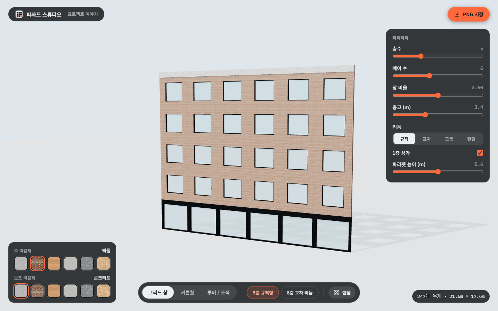
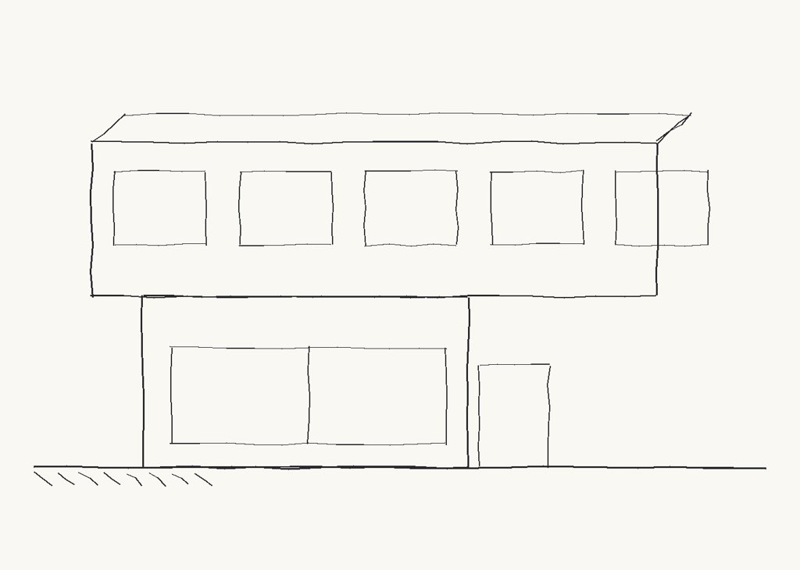
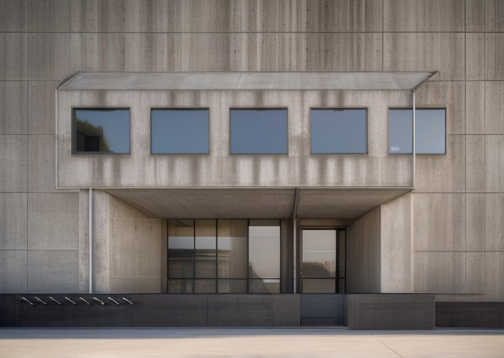
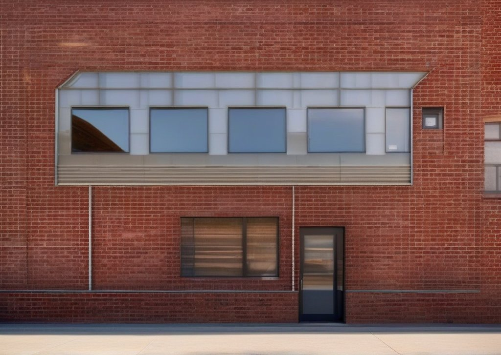
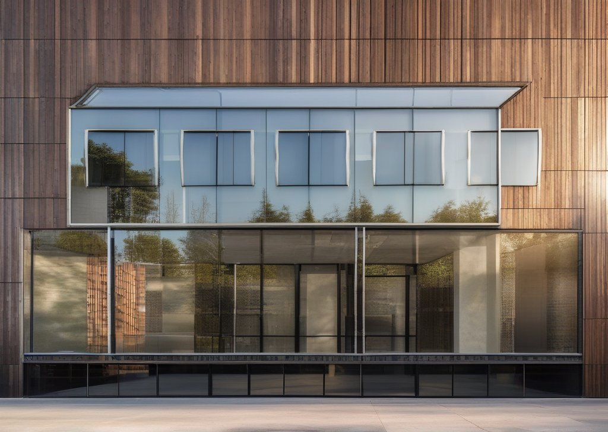
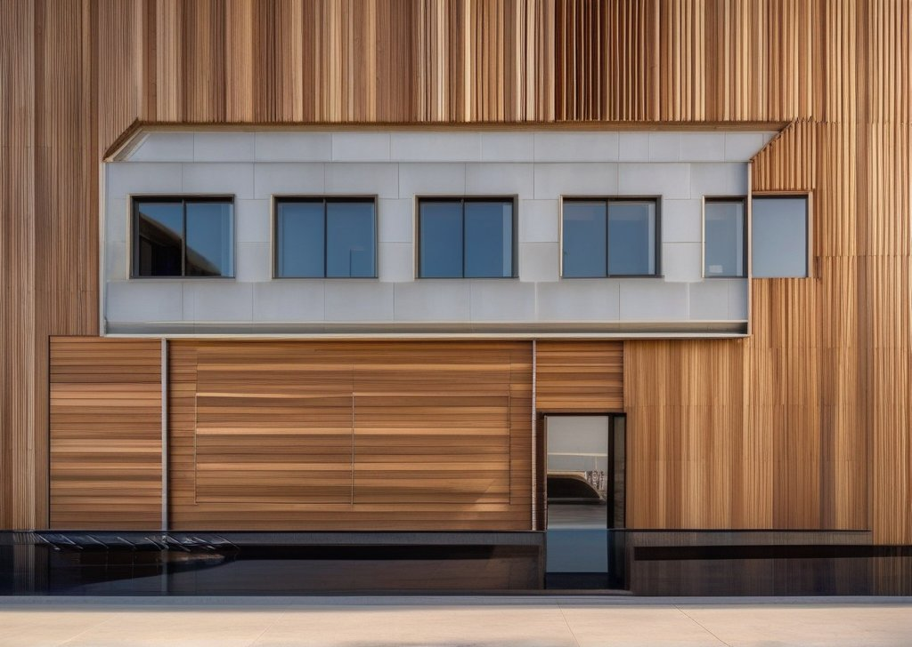

# 파사드 스튜디오

파라미터로 건물 파사드를 만들고 재질을 실시간으로 바꿔보는 브라우저 스튜디오입니다. GPU도 서버도 필요 없이 브라우저에서만 동작합니다.



**상태:** 로컬에서 실행할 수 있습니다. 아직 배포하지 않았습니다.

## 해보기

```bash
python -m http.server 8000 -d web
```

http://localhost:8000 을 엽니다. 3D 라이브러리(Three.js)와 글꼴을 CDN에서 불러오므로 인터넷이 필요합니다.

- 아래 독에서 파사드 유형(`그리드 창`, `커튼월`, `루버 / 조적`)과 프리셋을 고릅니다.
- 오른쪽 카드에서 층수, 베이 수, 창 비율, 층고는 슬라이더로, 리듬은 버튼으로 바꿉니다.
- 재질 카드에서 주 마감재와 보조 마감재를 바꿉니다. 넓은 화면에서는 왼쪽 아래에, 좁은 화면에서는 오른쪽 열에 있습니다. 6종 모두 실제 PBR 텍스처입니다.
- `랜덤`은 리듬을 `랜덤`으로 바꾸고 새 시드를 뽑습니다. 시드 슬라이더는 그때만 나타납니다.
- `규칙 편집`을 누르면 지금 유형의 규칙(JSON)이 오른쪽에 열립니다. 고치면 바로 3D가 바뀌고, 잘못 쓰면 규칙 경로와 함께 오류가 나오며 화면은 마지막으로 유효했던 규칙을 유지합니다. 고친 내용은 이 브라우저에 저장되고 `원래대로`로 되돌릴 수 있습니다.
- `PNG 저장`으로 지금 보는 화면을 저장합니다.

## 왜 이렇게 만들었나: GPU에서 브라우저로

처음에는 스케치 한 장에서 SDXL + ControlNet으로 파사드 렌더를 만들었습니다. 스케치의 형태를 지키면서 재질만 바꾼 결과가 나왔습니다.

| 입력 스케치 | 노출 콘크리트 | 적벽돌 | 통유리 커튼월 | 우드 루버 |
|---|---|---|---|---|
|  |  |  |  |  |

문제는 이 방식이 GPU가 있어야만 돌아간다는 점이었습니다. 무료로 쓸 수 있는 GPU(Kaggle)는 세션이 자주 끊기고, 이미지 생성 API는 무료 한도가 없었습니다. 그래서 공개 사이트에서 방문자가 직접 써볼 수 없었습니다. 그래서 방향을 바꿔, AI가 그림을 그리는 대신 **규칙으로 파사드를 만들고 브라우저에서 바로 그리는** 스튜디오로 다시 만들었습니다.

## 어떻게 동작하나

- **파사드 문법(shape grammar):** 입면(직사각형)을 `split`, `repeat`, `inset`, `emit`, `nil` 다섯 연산으로 쪼개 부재(박스) 목록을 만듭니다. 규칙은 JSON이고 해석기는 순수 JS입니다. 식은 직접 만든 작은 파서로 계산하며 `eval`을 쓰지 않습니다.
- **유형은 JSON 파일 하나:** 규칙, 파라미터 스키마, 프리셋이 한 파일에 들어 있고 슬라이더는 스키마에서 자동으로 만들어집니다. 새 유형을 추가하려면 JSON 파일을 하나 추가하면 됩니다.
- **같은 값이면 같은 결과:** 무작위 값은 모양마다 경로 해시로 시드를 정해서, 슬라이더 하나를 움직여도 전체가 뒤섞이지 않습니다.
- **렌더링:** Three.js. 재질 슬롯별로 `InstancedMesh` 하나를 쓰고, 재질을 바꿀 때는 지오메트리를 다시 만들지 않습니다. 박스에 입히는 텍스처가 늘어나지 않도록 월드 좌표 기준 UV를 직접 계산합니다.

## 구조

```
web/
  index.html            스튜디오 페이지
  studio/
    app.js state.js studio.css
    grammar/            문법 엔진 (순수 JS): expr, rng, rhythm, engine, validate
    types/              grid.json curtainwall.json louver.json + index.json
    view/               Three.js 장면, 재질, 컨트롤, 카메라 맞춤
  textures/             ambientCG 1K 텍스처 6종 + 견본 썸네일
  samples/              예전 SDXL 결과 이미지 (README에서만 사용)
spike/                  예전 ControlNet 실험 (노트북, 스케치)
tests/ tools/           테스트, 텍스처 내려받기와 견본 썸네일 만들기
docs/superpowers/       스펙과 구현 계획
```

## 테스트

```bash
npm test
```

Node 24에서 실행해 확인했습니다 (`node --test`를 지원하는 최근 버전이면 될 것으로 보이지만 다른 버전은 확인하지 못했습니다). 문법 엔진은 `node --test`로 검증합니다. 모든 유형이 모든 파라미터 극단 조합에서 부재가 겹치지 않고 입면을 빈틈없이 채우는지, 같은 입력이 같은 결과를 내는지, 식 파서가 위험한 이름을 거부하는지 등을 확인합니다. 3D 화면은 브라우저에서 직접 점검했습니다.

## 예전 갤러리 코드

처음에는 이 이미지들을 보여주는 갤러리 페이지와, 직접 올린 스케치를 Kaggle GPU에서 렌더하는 서버(`server/kaggle_server.py`, 실제로 돌려보지는 못했습니다)도 만들었습니다. 스튜디오로 방향을 바꾸면서 그 코드는 지웠고, 이미지(`web/samples/`)와 실험 기록(`spike/`)만 남겼습니다. 지운 코드는 git 기록에 있습니다: `git show 9c15fb3:web/app.js` 처럼 커밋 `9c15fb3`에서 꺼낼 수 있습니다.

## 크레딧

텍스처는 모두 [ambientCG](https://ambientcg.com)의 CC0 자료입니다.

| 재질 | 에셋 |
|---|---|
| 콘크리트 | [Concrete034](https://ambientcg.com/view?id=Concrete034) |
| 벽돌 | [Bricks085](https://ambientcg.com/view?id=Bricks085) |
| 목재 | [Wood095](https://ambientcg.com/view?id=Wood095) |
| 플라스터 | [PaintedPlaster017](https://ambientcg.com/view?id=PaintedPlaster017) |
| 금속 패널 | [MetalPlates008](https://ambientcg.com/view?id=MetalPlates008) |
| 석재 | [Tiles143](https://ambientcg.com/view?id=Tiles143) |

예전 갤러리의 스케치: `villa_elev`는 Rijksmuseum RP-T-1966-65-1(CC0)의 일부이고, `modern`은 직접 그렸습니다.

설계 문서: [스펙](docs/superpowers/specs/2026-10-12-parametric-facade-studio-design.md), [구현 계획 Part 1](docs/superpowers/plans/2026-10-12-parametric-facade-studio-part1.md), [구현 계획 Part 2](docs/superpowers/plans/2026-10-13-parametric-facade-studio-part2.md)
